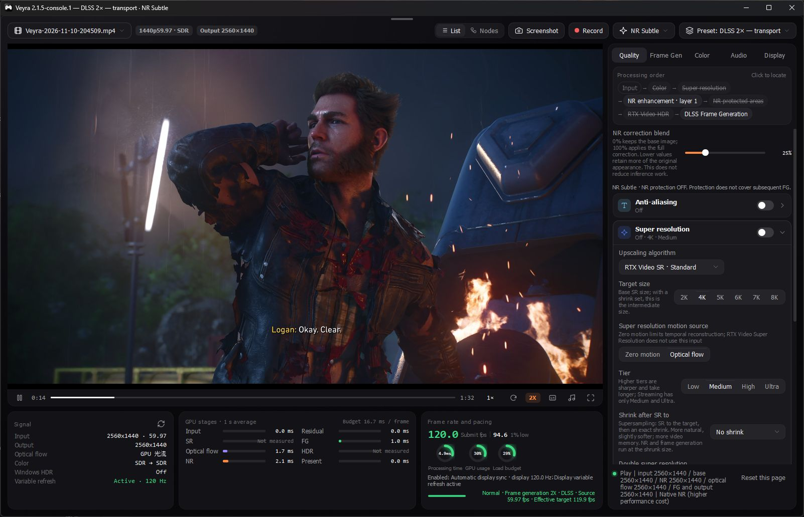
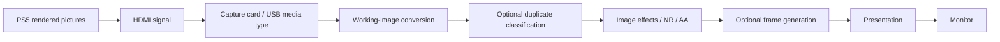
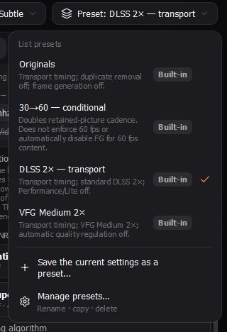
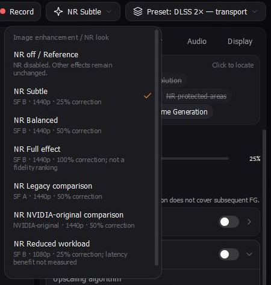
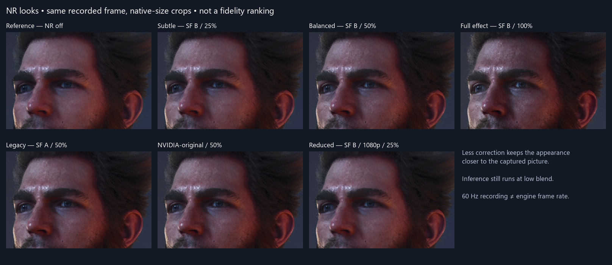
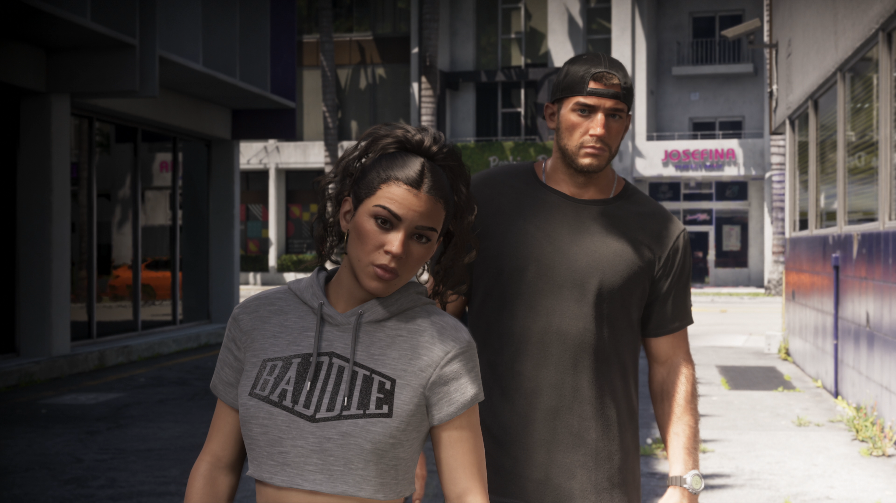
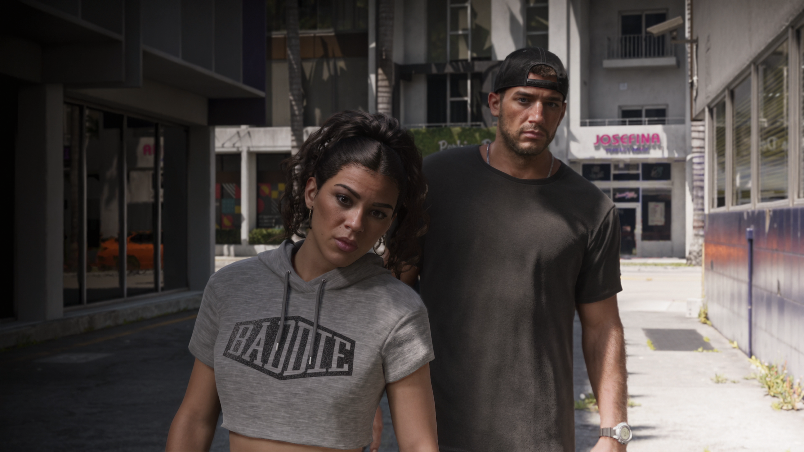
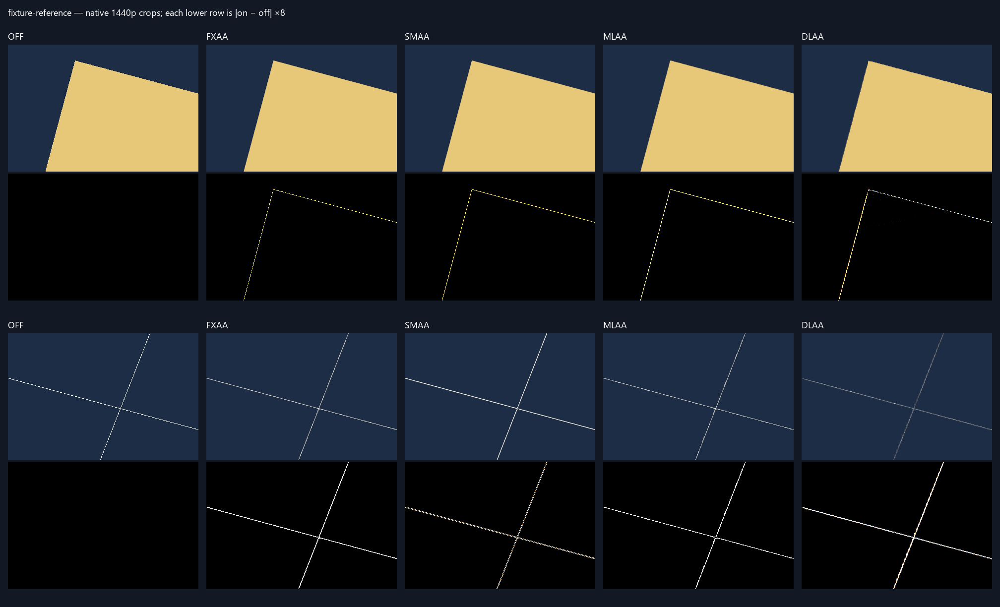
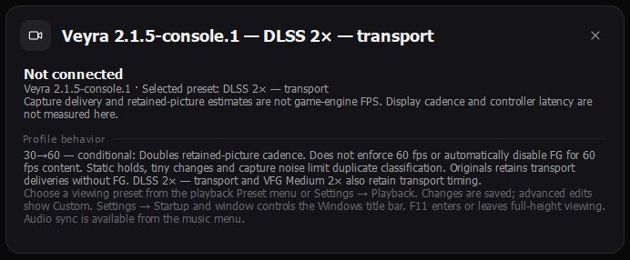

# Veyra Console

**Console video, comfortable on your desktop.** A Windows capture-card fork of [Likely7/Veyra-NRVideo](https://github.com/Likely7/Veyra-NRVideo), with independent controls for **motion delivery** and **image appearance**. Compare original pictures, frame generation and neural-restoration looks without rebuilding your capture, audio or window setup.

## TL;DR — what's different from regular Veyra?

**Regular Veyra already has AI image enhancement and frame generation. This fork makes those features easier to use for playing a console through a capture card.** Compared with Veyra **v2.1.5**, the main changes are:

- **Easy motion choices:** four presets let you keep the original pictures or try frame generation, which adds pictures between captured frames to smooth motion.
- **Separate image looks:** seven choices range from enhancement off to subtle or stronger AI changes. Switching a look keeps your motion, capture, audio and window settings. An easy blend slider helps keep more of the game's original appearance.
- **More convenient desktop viewing:** a normal Windows title bar lets you drag the player into FancyZones layouts. Full-height viewing and aspect-ratio fitting keep the game picture correctly proportioned.
- **Clearer settings and status:** see which motion preset and image look are selected, when you've customized them, and what capture format is actually connected rather than just requested.

**The underlying AI models and filters come from upstream.** This is mainly a console-focused usability and diagnostics fork; it has not been proven universally sharper, faster or free of stutters. **The public release is currently source-only**, with no ready-to-run Windows download; details below.

Developed from a private RTX 5090 / PS5 investigation. This independent GPL-3.0 project is not an NVIDIA, Elgato, Sony or upstream Veyra release. The enhancement algorithms are inherited; this fork makes their use and limitations clearer.

[Source preview](https://github.com/TripleJ160/Veyra-Console/releases) · [Runtime installation](docs/console/RUNTIMES.md) · [Build](docs/console/BUILD.md) · [Evidence](docs/console/EVIDENCE.md) · [Original README](README.upstream.md)

> **Source preview — Windows binary publication is blocked.** The locally tested application works, but its executable statically incorporates NVIDIA’s proprietary NGX core. Redistribution of that combination with this GPL project has not been established. Omitting model DLLs alone does not resolve it. This release publishes source, screenshots, checksums and validation evidence; **there is no public Windows application ZIP yet**. The existing private application is preserved. See [the distribution blocker](docs/console/RUNTIMES.md).

*Actual local AI-enabled build with separately installed runtimes, not a public binary download.*

## Quick start

These steps describe the **locally built application**. First [build from source](docs/console/BUILD.md) with legitimately obtained dependencies for permitted use. There is no public application ZIP in this source preview.

1. Deploy the Windows x64 build into a writable folder. Open **Veyra.exe**. The preserved private package also has its one-click launcher. Keep Qt, QML and shaders alongside it.
2. Close other software using the card. Open **Capture card**, choose video and HDMI audio devices, then an **enumerated** media type. Start with **2560×1440, 60 fps, NV12, SDR** if offered.
3. Connect and inspect **Connected capture — current session**. Requested settings describe the next connection. Connected dimensions, nominal rate, transport pixel format, measured delivery and input color describe this session.
4. Start with **Originals**, **NR off / Reference**, AA off and **Fit**. After [runtime installation](docs/console/RUNTIMES.md), try **DLSS 2× — transport**. The viewing presets leave Performance/Lite off.
5. For appearance, try **NR Subtle** and adjust **NR correction blend** in List → Quality. Reference turns NR off while retaining other effects.

The launcher does not open a device, install drivers, change display settings or import another installation's preferences. Settings persist locally. Use the controller directly with the console; this binary excludes Remote Play, Moonlight and Xbox streaming clients.

## Compared with upstream

Exact baseline: **v2.1.5**, commit **dc6f6e1e5e51b31d027e4d369949332c130238de**, not “latest upstream.” History, attribution and notices are retained. Research recordings and machine-specific logs stay local; selected source and tests are published.

| Capability | Upstream baseline | This fork | Evidence or limitation |
|---|---|---|---|
| DLSS FG, VFG and other FG adapters | Already implemented | Four named viewing presets | Existing scheduler/backends; no new model |
| NR Original / SF A / SF B | Already implemented | Seven independent looks | Optional runtimes required |
| Residual composition / style controls | Already implemented | Accessible correction shortcut | Lower blend is not lower inference cost |
| Manual protection regions | Already implemented | Retained across looks; status explained | Protects NR, not subsequent AA/FG |
| FXAA / SMAA / MLAA / DLAA | Already implemented | Verified paths; corrected List order display | No stronger filtering or invented engine jitter |
| Presets | General chain presets | Motion-only presets plus image looks | Independent persistence and Custom labels |
| Capture information | Selection and generic status | Requested versus connected format/color | Does not measure engine FPS or certify HDMI mode |
| Desktop viewing | Frameless/cinema/fullscreen | Native caption, FancyZones resizing, F10 access | Full-height 16:9 fit; no display-mode change |
| Audio controls | Existing sync/offset | Settings reachable without file tracks | Audio algorithm unchanged |
| Diagnostics | Frequent optional queries/logs | Gating in ordinary playback | Warnings retained; stalls not claimed resolved |
| Rejected-real fallback | Absent | Default-off research opt-in | Not a proven everyday latency fix |
| Packaging | Upstream package | Runtime audit and source preview | Binary redistribution blocked; private package preserved |

## Pipeline and four different rates

**Game-picture cadence** counts new rendered pictures. **Capture FPS** counts USB deliveries, including repeats. **Present submissions** count application output attempts, including generated pictures. **Display Hz** is monitor refresh rate. None alone measures controller-to-photon latency.

A 60 fps capture can carry repeated 30-picture content, unevenly repeated 40-picture content or approximately 60 distinct pictures. Static scenes and capture noise limit classification. Interpolation between A and B needs B to arrive; a higher counter cannot remove that wait.

## Motion: viewing presets

| Preset | Content handling | FG |
|---|---|---|
| **Originals** | Transport deliveries, including repeats | Off |
| **30→60 — conditional** | Existing Auto duplicate removal | Standard DLSS 2× on retained pictures |
| **DLSS 2× — transport** | Transport deliveries | Standard DLSS 2× |
| **VFG Medium 2×** | Transport deliveries | Medium 2×, automatic quality regulation off |

**Conditional does not enforce 60 fps or automatically disable FG at 60 distinct pictures/s.** It doubles retained cadence, which may be another rate; it does not blindly discard every second picture. Originals is useful when generation is unnecessary or introduces artifacts. Viewing presets retain image look, capture, audio and geometry. Legacy general presets can still replace a complete chain.

A 120 Hz display can repeat properly paced 60-picture output twice. Simply capping a 120-output stream to 60 does not guarantee alternating originals and midpoints. No new adaptive classifier or scheduler is introduced.

## Appearance: independent NR looks

| Look | Runtime/model | Requested video inference | Correction |
|---|---|---|---|
| **NR off / Reference** | Disabled | — | — |
| **NR Subtle** | SF B | 1440p, one layer | 25% |
| **NR Balanced** | SF B | 1440p, one layer | 50% |
| **NR Full effect** | SF B | 1440p, one layer | 100% |
| **NR Legacy comparison** | SF A | 1440p, one layer | 50% |
| **NR NVIDIA-original comparison** | Original | 1440p, one layer | 50% |
| **NR Reduced workload** | SF B | 1080p, one layer | 25% |

These are starting points, **not quality rankings**. Full effect may change art direction more. Reduced describes inference size, not measured latency savings. Smaller sources/still images follow inherited sizing. Looks require List mode; custom Node graphs are preserved.

SF A/B are choices within the supported **community-modified SF 310.9.16.0 runtime**. Original uses **NVIDIA-original 310.8.0.0**. Neither is bundled publicly. NR model B is unrelated to FG Performance/Lite. [Exact identities and paths](docs/console/RUNTIMES.md).

The inherited compositor adds a controlled model correction to the preserved base. Start near 25% to retain more source appearance. **Reducing blend still runs inference**; Reference disables NR. Each look uses one layer, optical-flow guidance, default appearance, extra stabilization/hold/reuse off, Auto mask and unconfirmed UI correction off. Shared flow provider/quality remain yours.

Looks retain FG/multiplier/content timing, AA, color, capture, audio and geometry. Manual changes show **Custom**. Protection regions and their enabled state survive switching; they protect NR only, not subsequent AA/FG artifacts.

*Settings comparison within this fork, using the same 1440p sequence and final crop. Not a fork-versus-upstream quality comparison or recovered ground truth. [Method and limits](docs/console/EVIDENCE.md).*

### Community NR appearance comparison

Two user-supplied screenshots of the same scene, preserved at their original **3840×2160** resolution. Click either image to inspect the full-size PNG.

| Screenshot A | Screenshot B |
|---|---|
|  |  |

*The exact NR model, correction strength and on/off assignment were not recorded with these images. They illustrate appearance differences, rather than a controlled quality benchmark. A lower correction blend can retain more of the source's art style; see the Subtle and Balanced looks above.*

## Anti-aliasing: working does not mean necessary

All four methods executed in bounded native-1440p video checks with NR off/on. Spatial methods improved controlled edges against a supersampled reference. Console video already contains game AA/upscaling, so differences can be subtle. **AA off** is a faithful default. Try **SMAA High**, temporal accumulation off, for residual jaggies. Enable the AA card as well as choosing a method.

DLAA uses captured color, estimated motion, constant guidance depth and zero engine jitter. It is not game-integrated DLAA. It changed broader texture and weakened some one-pixel lines; overall fidelity improvement is unresolved. Still images explicitly bypass it.

*Synthetic, not gameplay. Amplified differences are not ordinary output. With NR enabled: color → optional SR → NR → protection/beauty → AA → HDR → FG. With NR off, AA precedes SR. The List display now follows engine order.*

## Window, capture, color and audio

- **F10 → Startup & window → Show Windows title bar** enables the native caption. Shift-drag it into an existing FancyZones area. No PowerToys layout/global-setting changes.
- **F11** toggles fullscreen/full-height viewing. **Fit** preserves aspect ratio. On a **5120×1440** desktop, the full-height 16:9 image is **2560×1440**, with side space. F10 exits fullscreen into Settings.
- Custom resolution applies only when Custom is selected. FPS overrides are labeled. Connected values come from the active source, not stale request fields.
- HDMI input/passthrough and USB capture differ. 4K capture does not prove 4K console rendering. Inspect PS5 **Settings → Screen and Video → Video Output → current signal information**. For SDR, console/Windows HDR should be off; match RGB range to the capture path. Do not change working colors on assumption alone.
- Verified: Windows x64, RTX 5090, Ryzen 7 9800X3D, Elgato 4K S **1440p60 NV12 SDR**, Odyssey **5120×1440 at 120 Hz**, Windows HDR off. Other hardware/modes need separate verification. This is not new HDR validation.
- Select HDMI audio and use **Audio settings → sync/offset** as needed. Automatic sync is inherited. Processing changes may affect perceived sync; no new live-audio result is claimed.

## Requirements and licenses

Windows x64, D3D12 GPU and appropriate driver. Deploy matching Qt/FFmpeg/Microsoft runtime DLLs beside a local build. AI backends have individual hardware/runtime requirements; RTX 5090 is the verified AI configuration. Cards must expose a supported Windows media type. Direct HDMI passthrough remains a useful baseline.

See [runtime audit](docs/console/RUNTIMES.md). No automatic proprietary downloader, arbitrary DLL upgrade, driver replacement or new signature bypass. Adapter presence is not vendor certification.

This software uses [FFmpeg](https://ffmpeg.org), LGPLv2.1-or-later. The matching patched FFmpeg archive and Qt sources were collected locally for the withheld binary package. See source acquisition in the build guide and the [release status](docs/console/RELEASE.md). Qt is dynamically linked and replaceable. See [build instructions](docs/console/BUILD.md), [GPL](LICENSE) and [notices](THIRD_PARTY_NOTICES.md).

*No capture device was connected in this screenshot session; this is not proof of a live negotiated mode. The overview shows the native title bar. A clean full-height screenshot was not obtained in this publication run; geometry is described from source and prior validation.*

## Persistence, troubleshooting and rollback

Settings: this folder's `runtime_local/user-data-2.0.0`. Extract upgrades into a **new folder**. Keep the old folder; rollback means closing the new app and opening the old one. Reset by extracting a fresh ZIP without deleting saved data. One preview per capture device.

| Symptom | Check |
|---|---|
| NR unavailable | Menu reason, exact runtime folder/hash; restart after installation |
| FG selected but inactive | Applied status/backend error; selection is not successful generation |
| Weak NR/AA difference | Same picture/size, enable switch; source may leave little work |
| Zone behavior | Enable native caption; verify FancyZones activation separately |
| Washed-out/dark image | Connected range/matrix/transfer and fallback markers; SDR versus HDR |
| Stutters | Isolate with Originals/Reference; stalls remain unresolved |
| Custom label | Relevant settings differ; reselect preset if desired |

Normal playback gates optional display statistics and high-volume telemetry. Errors and slow-Present warnings remain. Diagnostics are optional. Software timing is not controller-to-photon latency.

## Limits and next work

No new AI models, universal sharpness gain, lower controller latency or resolved stalls are claimed. Recorded footage is not established native 30 fps. Rejected-real fallback stays off. Performance/Lite stays off pending adapter investigation. Lossless Scaling is a separately licensed external alternative, not an automated dependency.

Next: classification/status reliability; isolate avoidable presentation waits while preserving ownership/history; improve runtime discovery/provenance. New models, stacked effects and scheduler rewrites are not prerequisites for normal play.
